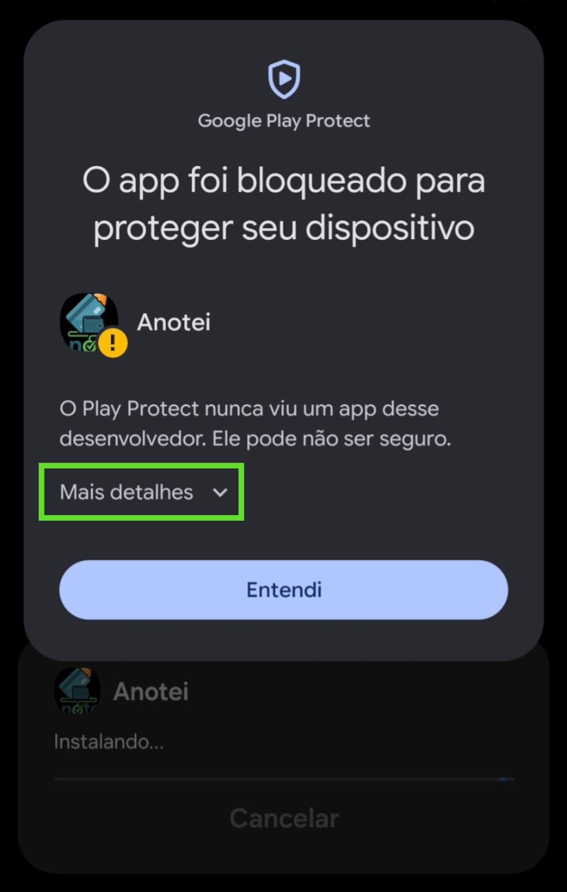
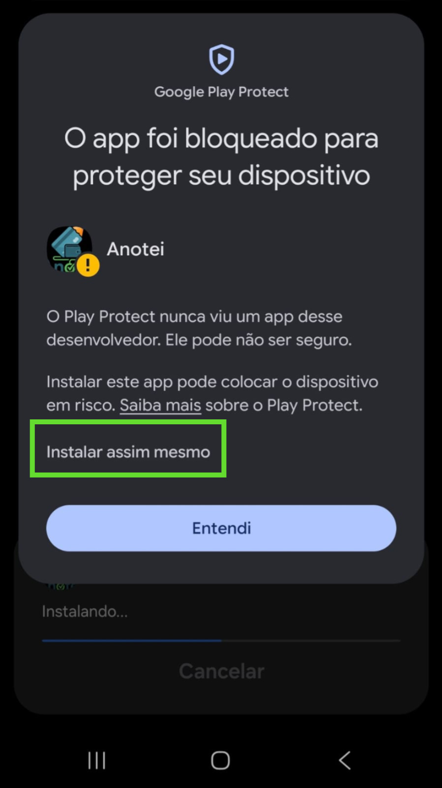
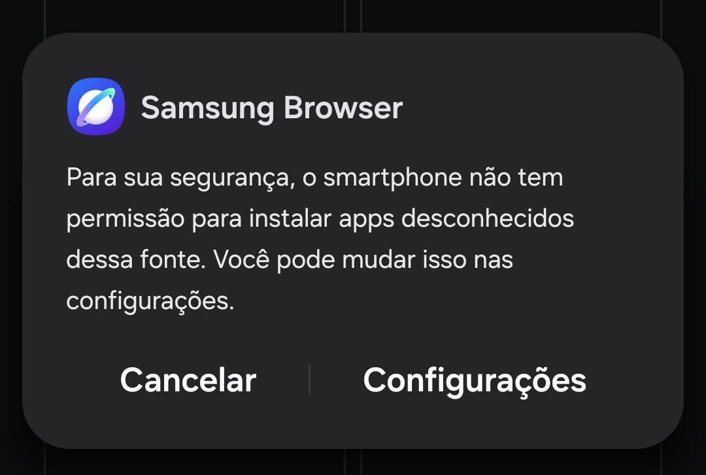
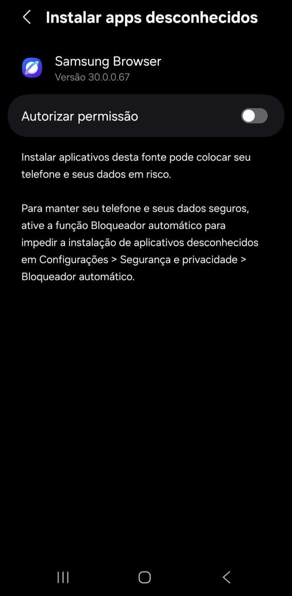

<p align= 'center'>
  
</p>

---

## 📱 Anotei - Controle Financeiro Pessoal

**Anotei** é um aplicativo móvel leve, moderno e intuitivo desenvolvido para ajudar você a registrar seus gastos diários e gerenciar suas contas recorrentes de forma simples. Focado em praticidade e privacidade, o app funciona de maneira totalmente offline, mantendo todos os seus dados financeiros seguros dentro do seu próprio dispositivo.

## ✨ Principais Funcionalidades

- **Registro de Gastos Diários:** Cadastre suas despesas de forma rápida, separando os registros entre transações no Débito e Crédito.

- **Resumo Financeiro Automático:** Acompanhe em tempo real na tela principal o total geral acumulado, além dos valores específicos gastos em cada modalidade de cartão.
- **Gestão de Contas Fixas (Recorrentes):** Controle seus boletos e contas do mês informando o nome, valor, data de vencimento e observações personalizadas.
- **Barra de Progresso Dinâmica:** Veja de forma visual a porcentagem de contas pagas no mês conforme você marca as pendências como concluídas.
- **Privacidade Absoluta (100% Offline):** Seus dados são seus. Nenhuma informação é enviada para servidores externos ou bancos de dados na nuvem; tudo é persistido de forma segura localmente no aparelho.

## 🛠️ Tecnologias Utilizadas

Este projeto foi construído utilizando as melhores práticas do ecossistema React Native:

- **Framework:** React Native (Expo)
- **Linguagem:** TypeScript
- **Navegação:** React Navigation (Native Stack)
- **Armazenamento Local:** AsyncStorage (Persistência local rápida)
- **UI Components:** React Native Paper e Componentes Personalizados

## 📥 Download e Instalação (Android)

Você pode testar a versão estável do aplicativo diretamente no seu celular Android sem precisar configurar um ambiente de desenvolvimento:

👉 **Clique [aqui](https://github.com/mhenriquers/Anotei/releases/download/v1.0.0/Anotei.apk) para baixar o APK**

### Passo a passo para instalar:

1. Clique no link acima para baixar o arquivo `.apk` diretamente em seu smartphone.
2. Ao finalizar o download, toque no arquivo para iniciar a instalação (caso o Android solicite permissão para "Instalar aplicativos de fontes desconhecidas", basta habilitar nas configurações).
3. Abra o app e comece a organizar suas finanças!

## 🍎 iPhone (versão web / PWA)

No iPhone o Anotei funciona como app web instalável, sem passar pela App Store:

👉 **Abra [mhenriquers.github.io/Anoteipwa](https://mhenriquers.github.io/Anoteipwa/) no Safari**

1. Toque em **Compartilhar** (se não aparecer, toque em **···** primeiro).
2. Escolha **Adicionar à Tela de Início**.
3. Abra o Anotei pelo ícone que aparece na tela de início.

Diferenças em relação ao app Android:

- **Sem notificações:** no lugar delas, a tela inicial mostra as contas atrasadas e as que vencem nos próximos 7 dias.
- **Backup:** os dados ficam só no aparelho. Na tela inicial há os botões **Fazer backup** (salva um arquivo em Arquivos/iCloud, WhatsApp etc.) e **Restaurar**. O app lembra de fazer backup a cada 30 dias.
- **Use sempre pelo ícone:** no iPhone, o Safari e o app instalado guardam os dados separados, por isso o app pede para ser instalado antes de usar.

## 📸 Permissão para app de terceiros:

Como o app não é esta na GooglePlay, talvez o dispositivo bloqueie a instalação. abaixo estão algumas soluções:

### Google Play Protect

  

  

### Samsumg browser

  
  
  

## 🧑‍💻 Como rodar o projeto localmente

Se você deseja clonar o repositório e executar o código em sua máquina:

1. Clone o repositório:
   ```bash
   git clone https://github.com/mhenriquers/Anotei.git
   ```

### Versão web (PWA)

```bash
npm run web        # roda no navegador em modo de desenvolvimento
npm run build:web  # gera a versão publicável em dist/ (app + service worker)
```

A cada push na branch `main`, o GitHub Actions ([.github/workflows/deploy-web.yml](.github/workflows/deploy-web.yml)) gera a versão web e publica no GitHub Pages. Na primeira vez, é preciso ativar em **Settings → Pages → Source: GitHub Actions**.
